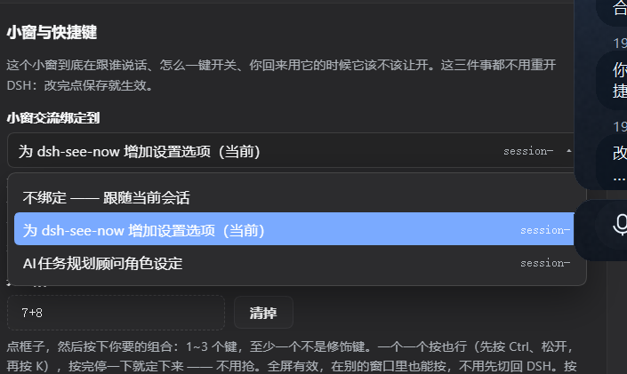
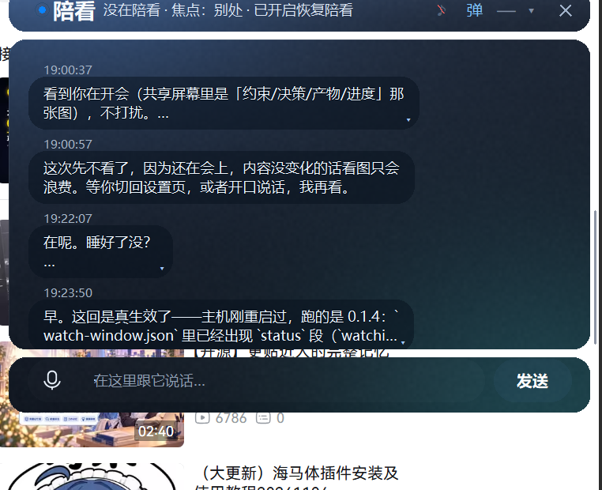

# dsh-see-now-extras

给**已经装好的** [`dsh-see-now`](https://github.com/SAOS-3624/dsh-see-now) 打一层补丁，加上五个开关：

| 开关 | 默认 | 作用 |
| --- | --- | --- |
| 小窗交流绑定到某个会话 | 不绑定 | 钉死之后，小窗里打的字、陪看的叫醒、写进小窗的回答，全都归这一个会话；不绑就跟随"最后说话的那个" |
| 自定义快捷键（1~3 键） | 没设 | 全局按一下就开/关陪看（Windows，全屏也有效） |
| DSH 一到前台就停陪看 | 关 | 你切回来用 DSH，它先停手，不抢你的键盘和屏幕 |
| 被打断后自动续看 | 开 | 上面那个开关打开时，你切走它自己接着看（不想要就关掉这一条） |
| 按快捷键时顺手拉起小窗 | 开 | 关掉 = 快捷键只开始看，不在屏幕上硬开一个窗 |

悬浮窗顶栏还会多一行状态（**陪看中 / 焦点DSH，暂停 · 已开启恢复陪看**），右上角多一个「♪」静音键 ——
只关声音，聊天照旧；静音时它会告诉模型"别写'我念给你听'"。

开关都在 **设置 → 看你看的东西 →「小窗与快捷键」** 这张卡片里，改完立刻生效（不用重开 DSH）。



悬浮窗顶栏那行状态和 ♪ 静音键长这样：



它**不**替代 see-now：看屏幕、悬浮窗、语音、拼图全都还是官方那份，我们只往里面加了上面这几样。

---

## 为什么是"补丁"，不是"另一个插件"

这几样都要动 see-now 自己的采集循环（"陪看归哪个会话"）、宿主会话列表（下拉框取标题、滤掉归档）
和它自己的设置页。靠 `see_now` 的公开参数做不到，fork 一份又会让用户从官方更新里掉队。

所以这里只做一件事：**把改动写进你装好的那个包里**。

- 官方包照旧由 npm / pnpm 管；
- 补丁包自带 `apply` / `revert`，随时能一字不差地回到原版；
- 动手之前逐个文件核对官方原版的 sha256，版本对不上就一个字都不写。

## 装法

**0. 先装官方包**（已经装了就跳过）：

```bash
dsh plugin --profile <你的 profile> add dsh-see-now
```

**1. 装补丁包**：

```bash
dsh plugin --profile <你的 profile> add /路径/dsh-see-now-extras-0.1.10.tgz
```

（`dsh plugin` 的参数是原样转给 pnpm 的，所以本地 tgz、npm 包名、目录路径都行。）

**2. 打补丁**：装好之后直接对 DSH 说一句

> 把 see-now 的补丁装上

模型会调 `see_now_extras({action:"apply"})`。它先验版本、再备份、再写文件，
最后告诉你改了几个文件。也可以让它 `action:"status"` 先看一眼。

**3. 重启 DSH**。设置页那张卡片是跟着宿主一起打包的，不重启看不到。

> 补丁包自己也能在别的机器上打同一份补丁 —— 它自带 `payload/` 和 `patch.json`（官方原版的哈希指纹），
> 不依赖打包时的那台机器。

## 几个开关怎么用

### 小窗交流绑定到某个会话

- 下拉框里是**没有归档、说过话**的会话（新开的空会话只有"当前"那个会露出来，免得一枚空壳占着位置）。
- 选中一个 = 钉死：`see_now` 的叫醒、小窗里打的字、写进小窗的回答，都归它。
- 选「不绑定」= 跟着最后说话的会话跑（和官方原来的行为一样）。
- 绑的那个会话后来被关了：选项还在，后面标「（这个会话现在找不到了）」，不会悄悄退回"不绑定"。

不绑定时，你在小窗打字只有在**陪看循环跑着**的时候才会被接住（官方的行为）。
绑了会话之后，**没在陪看**时打的字也会被送到那个会话 —— 小窗不再是个黑洞。

### 自定义快捷键

- 点虚线框，按下你想用的 1~3 个键，**手停下来 0.7 秒**才定稿（这样才有时间按 `Ctrl`、`Alt`、`K` 三个键）；
  想反悔就在定稿前按 `Esc`。
- 全局有效，包括全屏游戏/视频；再按一次就停。
- **别用** `Ctrl+W` / `Ctrl+R` / `Ctrl+Q` / `F11` 这类：它们一按就有别的程序抢着响应
  （我们绕开了"注册热键"那套 —— 一个组合键只能被一个程序注册，撞上就静默失效）。
- 本补丁只支持 **Windows**（靠 `GetAsyncKeyState` 轮询，30ms 一次，不注册、不占键）。

### DSH 一到前台就停 / 被打断后自动续看

- 前一条靠检测"前台窗口是不是 DSH 的进程"。**只在 Windows 上有**；其他平台这一条会显示"用不了"。
- 只有"正在陪看"的时候才会被它打断：光开着 DSH 不会去停一个没在跑的东西。
- 后一条默认开：切回来 → 它停；切走 → 它接着看。
  不想要"自己又动起来"就关掉它，那样切走后它会说一句「你切走了，自动续看是关的」，等你按快捷键或者再说一声。

### 按快捷键时拉不拉小窗

默认**拉**：一按快捷键，窗就出来（否则屏幕上什么都没发生，很容易以为按键坏了）。
关掉之后，快捷键只开始采集和叫醒，不再硬把窗拉回来 —— 适合"只想让它在旁边看着、不想屏幕上多个东西"。

### 会话下拉的两个小细节

- 点面板外面任意位置就收起来，不用再点一次那个按钮。
- 右边是会话 id 的前 8 位，**鼠标停上去能看完整 id**（标题重名时靠它对号）。

## 还原 / 卸载

**只想回到原版**：对 DSH 说「把 see-now 的补丁还原」，或者调 `see_now_extras({action:"revert"})`。
它会放回备份、删掉新增的文件，然后 **重启 DSH**。

**连补丁包一起卸**：

```bash
dsh plugin --profile <你的 profile> remove dsh-see-now-extras
```

> 顺序很重要：**先 revert 再 remove**。反过来的话，包里那份补丁文件还留在 see-now 里，
> 而"怎么还原"的记录跟着补丁包一起没了（备份还在 `~/.dsh/see-now-extras/backup/`，
> 但要手工放回去）。实在乱掉了最省事的办法是重装 see-now 本身。

## 它改了哪些文件

| 文件 | 为什么 |
| --- | --- |
| `client.js` | 设置页多一张「小窗与快捷键」卡片：会话下拉、快捷键录制、两个勾选框、伴生进程状态 |
| `src/index.js` | 会话归属（`talkTarget`）、快捷键开关陪看、焦点暂停/续看、空闲时把小窗的话转发给绑定会话、会话列表带标题并滤掉归档 |
| `src/tuning.js` | 五个新设置项（`talkSession` / `hotkey` / `focusPause` / `focusResume` / `hotkeyWindow`）的读写与校验 |
| `src/settings-api.mjs` | `/status` 多带回会话列表和伴生进程状态；保存成功后把新配置热应用 |
| `src/window.js` | 顶栏状态（陪看 / 焦点 / 自动续看）与静音的读写（`watch-window.json` 的 `status` 段） |
| `src/chat.js` | 静音时**只跳发声**，字照样写进小窗；送图给模型时附带"用户静音了"的提示 |
| `src/loop.js` | 唤醒文案带上静音提示（否则模型会写"我念给你听"） |
| `examples/floating-chat/window.py` | 悬浮窗顶栏那行状态（陪看中 / 焦点DSH，暂停 · 已开启恢复陪看）和 ♪ 静音键 —— 它是独立的 Python 进程，界面画在它自己身上 |
| `src/hotkeys.js` | **新增**：快捷键的规范化（1~3 键、修饰键在前、别名归一） |
| `src/companion.js` | **新增**：拉起/重配那个监听键盘和焦点的伴生进程 |
| `examples/floating-chat/companion.py` | **新增**：伴生进程本体（`GetAsyncKeyState` + 前台窗口检测，stdin/stdout 一行一 JSON） |

五个新设置项也写进了 `~/.dsh/see-now.json`，手改那个文件同样有效
（但热键和焦点这两条要重启 DSH，或者重新保存一次设置页）。

## 出问题的时候

- **`status` 说版本对不上**：补丁是照着 `dsh-see-now@0.2.0` 写的。装了别的版本就先别打
  （等这份补丁跟上，或者装回 0.2.0）。
- **`status` 说某个文件 `foreign`**：那个文件被别人改过（或者你自己动过）。补丁不会覆盖它。
- **找错了 see-now**：设环境变量 `DSH_SEENOW_DIR` 指到那份包，再让模型 `status`。
- **快捷键没反应**：先看设置页那张卡片底下的"快捷键服务"一行 —— 它要是"起不来"，后面会跟原因
  （常见：没装 Python 3.8+，或者被杀毒软件拦了）。
- **备份在哪**：`~/.dsh/see-now-extras/backup/0.2.0/`（`files/` 是原版文件，`state.json` 是这次打补丁的记录）。

## 许可

补丁里改的是 see-now 的源码（Apache-2.0），本包同样以 Apache-2.0 发布，见 `LICENSE`。
